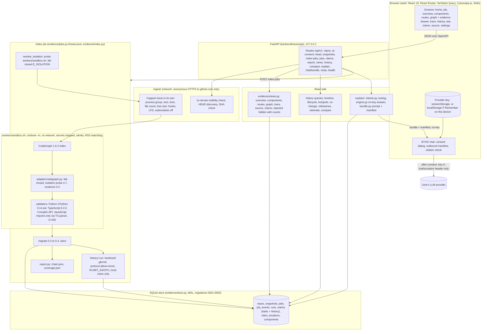

# Traces v1 architecture

Head: `build/traces-v1` at `0f32d4d`. Checked against the code on 2026-10-23 IST. Ownership is in [CONTRACTS.md section 6](../CONTRACTS.md); decisions are in [DECISIONS.md](../DECISIONS.md).

## Components and data flow

## What each part does

| Part | Code | Role |
| --- | --- | --- |
| Web | `web/` | Single-page app. Calls only the Traces API, except BYOK chat, which calls the provider directly from the browser |
| API | `backend/traces/api` | FastAPI app and models; `docs/contracts/openapi.json` is the UI contract (D-014). Request models forbid extra fields. 422 bodies never echo input (D-028) |
| Store | `backend/traces/evidence/store.py` | One SQLite file (`$TRACES_DATA_DIR/traces.sqlite3`), WAL, per-thread connections, forward-only migrations 0001-0003 |
| Ingest | `backend/traces/ingest` | Public GitHub HTTPS URLs only, anonymous `ls-remote`, pinned SHA, capped clone, cleanup in `finally`, git in its own session (D-021, D-028, D-031) |
| Isolation | `evidence/pipeline.py`, `workers/sandbox.sh` | Fails closed unless `unshare -rn` is shown to work; `TRACES_ISOLATION=off` is an explicit dev override recorded on the snapshot (D-026) |
| Indexer | `toolchain/` (CodeGraph 1.6.2) | Runs inside the sandbox; never runs target code |
| Adapter | `backend/traces/adapter/codegraph.py` | Fail-closed mapping to evidence 0.3; `claim_id` v3, consolidation, EOF rules (Task 002) |
| Validators | `backend/traces/validators` | Independent checks: Python `ast`, TypeScript Compiler API, JavaScript imports only (D-030). Status rules from Task 002 |
| Report | `backend/traces/evidence/report.py` | `chain.json` and `coverage.json` per baseline run (F7) |
| History | `backend/traces/history` | Git history facts and patterns (timeline, lifecycle, churn, hotspots, co-change, milestones, aliases opt-in). Co-change is a pattern, never a dependency |
| Views | `backend/traces/evidence/views.py` | Read-only queries over the store; rejected hidden by default with `hidden_counts` and `truncated_counts` |
| Explain | `backend/traces/explain` | Deterministic, no LLM. Intent routing, cited answer or `unknown`. `chat/bundle` returns a scoped prompt and an outbound manifest with sha256 per line |
| BYOK chat | `web/src/features/chat` | Key held in the browser only; consent before each send; manifest equals what is sent; rejected claims stripped; answers checked for citations |

## Isolation, as built

- CodeGraph, the adapter and the validators run inside `workers/sandbox.sh` under `unshare -rn`. CT15 and `tests/security/test_outbound.py` check it.
- The clone runs outside the sandbox because it needs the network. It is anonymous HTTPS to github.com with hooks, LFS, submodules and credential prompts off.
- History runs in the job thread, not inside `unshare -rn`. Its only subprocess path is `history/gitcmd.py`, which refuses network transports (`protocol.allow=never`, no lazy fetch) and sets RLIMITs, on a local clone. `docs/contracts/history.md` (Safety section) says the index worker runs history under `unshare -rn`; the code does not. Recorded as a v1 limit in the review package.
- The API process itself makes no outbound connection on read, explain or chat-bundle endpoints (`test_outbound.py`).
