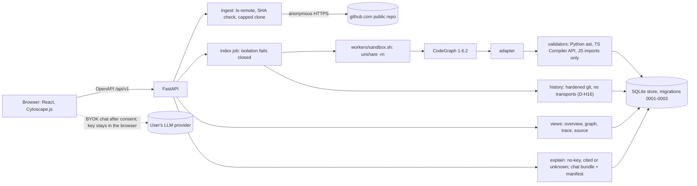

# Traces v1 review package

| | |
| --- | --- |
| Build | `build/traces-v1` at **`033e1f8`** (merge of PR #41). When PR #21 (this package) merges, its merge SHA is the v1 build |
| Acceptance | Lab final pass at `0f32d4d` ([ACCEPTANCE.md](../ACCEPTANCE.md), Lab `4289d1e`, merged in #40). `033e1f8` adds only #39 (history doc, D-H16), #40 (Lab docs and tests) and #41 (O-13 explain fix) |
| CI on `033e1f8` | Green, 11 of 11 jobs: push [39938654127](https://github.com/ShaileshRawat1403/traces/actions/runs/39938654127), pull_request [39938661185](https://github.com/ShaileshRawat1403/traces/actions/runs/39938661185) |
| Package updated | 2026-10-23, about 16:05 IST |
| Charter | Issue #2, section 7 |
| Companion docs | [ARCHITECTURE.md](ARCHITECTURE.md), [ROLLBACK.md](ROLLBACK.md), [STATUS.md](../STATUS.md), [ACCEPTANCE.md](../ACCEPTANCE.md), [DEMO_SCRIPT.md](../acceptance/DEMO_SCRIPT.md), [REVIEW_V1_EVIDENCE.md](REVIEW_V1_EVIDENCE.md), [REVIEW_V1_ADDENDUM_b37eef2.md](REVIEW_V1_ADDENDUM_b37eef2.md) |

## Walkthrough for Shailesh

The app runs on Architect1's computer. Open http://127.0.0.1:5731 in its desktop browser. It serves `033e1f8` with real data, indexed through the API: `fastapi/full-stack-fastapi-template@b1125d8` (fsft) and `pallets/itsdangerous@672971d`. Both were re-indexed at `0f32d4d` under `unshare` isolation.

Short paths used below: `F` = `/r/github.com__fastapi__full-stack-fastapi-template/s/b1125d8839482cb7bbae603ddc6d0081bf87532e`, `I` = `/r/github.com__pallets__itsdangerous/s/672971d66a2ef9f85151e53283113f33d642dabd`. About 12 minutes in total.

| # | Open | What to look at |
| --- | --- | --- |
| 1 | `/` (Home) | The URL box and the registered repos. Indexing a new repo is the same path the two shown repos took |
| 2 | `/jobs/j_d4c00e3c7141453898ef` | A finished index job: Fetch, Pin, Extract, Adapt, Validate, Store, History, all Done |
| 3 | `F` (Overview) | The pinned commit `@b1125d8`, the banner "Static analysis only. No runtime behavior has been observed.", and the layer bands. The README heading and frameworks are labelled interpretation |
| 4 | `F/components` | Each component has a layer and a reason naming the files counted and the rule, e.g. "docs: 6 of 21 file(s) are documentation files" |
| 5 | `F/routes` | 32 routes. `POST /api/v1/items/` points to `create_item` at `items.py:61` and is Verified. Frontend routes with no recorded method show `UNKNOWN` with a flag rather than a guess |
| 6 | `F/graph` | Components first; "Rejected claims are never drawn"; hidden counts include "12 rejected". Search `create_item`, switch to the list, click **Open evidence** on "create_item depends_on get_db" |
| 7 | Evidence drawer (from 6) | Status Verified, the location `backend/app/api/routes/items.py:63` at the pinned commit, the source lines, and the check that passed ("Depends(get_db) resolves to backend/app/api/deps.py:21") |
| 8 | `F/source?path=backend/app/api/routes/items.py` | The file at `b1125d8`, read from Git, with line numbers. Nothing here is live code |
| 9 | `F/trace` | 10 steps from the Items screen to `get_db`. Two dotted library steps (react-hook-form, TanStack Query) stay Inferred. One gap stays open. The last step says "Static persistence path". Nothing ran and no database was contacted |
| 10 | `F/trace?from=read_items` | "Incomplete: this trace has 1 step with calls the trace cannot follow." The gap card lists those calls. A trace never claims to be complete while calls are unresolved |
| 11 | `F/review` | 12 rejected claims: the 9 wrong CodeGraph imports and the 3 injected negatives (flagged injected control). None is ever verified |
| 12 | `F/history?tab=milestones` | 8 milestones. "Move new-frontend to frontend (#652)" moved 96 files and cites commit `9d703df` |
| 13 | `F/history?tab=cochange&target=backend/app/crud.py` | `crud.py` and `test_users.py` changed together in 5 of 26 commits, with "It is not evidence of a code dependency". Co-change is a pattern, not a cause |
| 14 | `F/ask`: "When was new-frontend moved to frontend?", **Explain (no key needed)** | A summary first, then the 96-file move `9d703df` ranked first. Each history sentence carries the pattern caveat. No model, no key |
| 15 | Same page: "Does create_item write to the database at runtime?" | First "runtime behavior is unknown", then the verified static persistence path through `get_db` with its location (O-13, fixed in #41) |
| 16 | BYOK consent dialog: **Settings**, choose Local Ollama (no key needed), **Save provider**; back on `F/ask`, type a message in the chat panel, click **Review what will be sent** | The "Review what will be sent" dialog: Destination (provider, endpoint, headers), Manifest (each evidence line with its sha256) and the Exact request body. Click **Cancel, send nothing**. No model runs on this computer, so do not press Send. With a real key, the key is sent only to the provider, never to Traces |
| 17 | `I` and `I/graph` | Second repo, a Python library: no routes, shown as an absence of records. Component `src/itsdangerous` is in the Library layer with its reason. 0 rejected claims after the F-4 and F-5 fixes. Unvalidated edges are hidden by default, not deleted |
| 18 | Browser devtools at 360 px wide: `F/trace`, tap **Open evidence**; then `F/graph` | The flow and drawer fit the phone width, with no sideways scroll |

Two notes in DEMO_SCRIPT.md's "Things to say" section are out of date. Routes, Components and Source now render real data (G-3 closed). Ask now routes by intent (F-7 fixed), so "What does create_item depend on?" answers with `get_db` and `get_current_user`.

**Known limits to expect on the walk:**
- Graph and trace take about 0.6 to 0.9 s on fsft (L-1).
- JavaScript repos: only imports can be verified; calls and references stay unvalidated (L-2).
- Express routers mounted with `forEach` show their local path without the prefix (L-3). Mongoose writes are not detected (L-4). Neither appears on fsft.
- README heading and framework names are uncited interpretations (L-5).
- The graph cuts at its limit and says how many it cut by status; it does not page (L-6).
- A BYOK key stays in browser storage by design (L-7). Chat against a live provider is untested (L-8).
- History compare is an identity diff of static claims, because milestone SHAs are not re-indexed (H3).
- History Git runs in the index job without its own `unshare` namespace, with network transports refused (D-H16).

## 1. How to run it yourself

From the README and [SETUP.md](../SETUP.md). You need `uv` and Node 20.19 or newer on Linux, and `unshare -rn true` must succeed; otherwise indexing fails closed with `E_ISOLATION`.

```bash
git clone https://github.com/ShaileshRawat1403/traces && cd traces
git checkout build/traces-v1
./scripts/start.sh        # or: make start. API http://127.0.0.1:8000, web http://127.0.0.1:5173
TRACES_API_PORT=8731 TRACES_WEB_PORT=5731 ./scripts/start.sh   # other ports
```

`start.sh` installs from lockfiles (`uv sync --frozen`, `npm ci --ignore-scripts`), starts the API, waits for `/api/v1/health`, then serves the web UI. Paste a public GitHub URL on the home page and follow the job. Data goes to `.traces-data/`, pinned checkouts to `.cache/`.

```bash
uv run --frozen python -m traces.evidence.pipeline baseline --run-id dev1   # about 1 minute; fetches fsft@b1125d8
uv run --frozen traces import-run .traces-data/runs/dev1                     # load it into the store
make test-fast                       # unit + API
make test                            # everything incl. a fresh baseline (CT1-16, RT1-8)
make lint typecheck                  # ruff, mypy, web tsc
cd web && npm test && npm run check:api && npm run build
ci/run_local.sh                      # every CI job locally (see ci/README.md)
```

## 2. Architecture

Full diagram and module table: [ARCHITECTURE.md](ARCHITECTURE.md).



## 3. Seat-to-module map

From [CONTRACTS.md section 6](../CONTRACTS.md).

| Seat | Modules |
| --- | --- |
| Traces | `backend/traces/{evidence,adapter,validators,ingest,core,api}`, `workers/`, `toolchain/` |
| Traces History | `backend/traces/history`, `docs/contracts/history.md`, `docs/history/` |
| Traces UI | `web/`, `backend/traces/explain` |
| Traces Lab | `tests/e2e`, `tests/security`, `tests/perf`, CI workflow, `docs/ACCEPTANCE.md`, `docs/acceptance/` |
| Architect | `docs/CONTRACTS.md`, `docs/DECISIONS.md`, `docs/STATUS.md`, `docs/review/`, merges into `build/traces-v1` |

## 4. Section 7 checklist (Lab final pass)

Status and proof are Lab's, from [ACCEPTANCE.md section 1](../ACCEPTANCE.md) at `0f32d4d`, CI run [39930532720](https://github.com/ShaileshRawat1403/traces/actions/runs/39930532720). Changes since that pass are noted in the last column.

| # | Charter item | Lab status | Lab proof | Since the pass |
| --- | --- | --- | --- | --- |
| 1 | Valid public URL, index status, pinned SHA, overview | **Pass** (CI) | `tests/api` 95 passed incl. `test_index_baseline.py` (product index of fsft@b1125d8) and the F-6 `sha_not_found` guards; demo steps 1-3 | none |
| 2 | Interactive graph, focus, cross-file edges, pinned source | **Pass** (CI) | e2e on the real fsft seed 94 passed, 4 skipped by design; demo steps 4, 5, 15; Routes, Components and Source pages render real data (G-3) | none |
| 3 | Nine Task 002 links, persistence static only, H1/H2 inferred | **Pass** (CI) | regression 16 passed (`test_nine_links_and_library_hops`); demo step 6 | none |
| 4 | Nine wrong imports not verified; three injected rejected; 16+8 | **Pass** (CI) | contract 17, regression 16; demo step 7 (12 rejected = 9 imports + 3 injected) | none |
| 5 | Git-backed change with cited commits; co-change not causality | **Pass** (CI) | history 176 passed, 0 skipped; `test_cochange_explain.py`; demo 8-10 (O-12, F-8, O-4 fixed) | none |
| 6 | No-key mode; provider mode with citations and privacy | **Pass** (CI) for no-key and stub provider | explain 96; `test_no_key_and_caps.py`; `chat_g5.cjs` 13 of 13; O-13 open at the pass | **O-13 fixed in #41**. Live provider untested (L-8) |
| 7 | Second, different repo; unknowns instead of invented links | **Pass** (local re-index, CI pattern tests) | itsdangerous 3,312 claims, 357 verified, 0 rejected; markupsafe 233 verified, 0 rejected; Express 107 of 107 imports verified (F-10), `register` trace incomplete with unresolved calls (F-9), route explain cites the route (F-11) | O-15 accepted (section 9b). L-2 to L-5 apply |
| 8 | Safe, visible failures | **Pass** (CI) | security 136 passed, 0 xfailed: bad URLs, traversal, symlinks, F-1, F-2, caps, timeouts, 429, no-key, key not echoed (F-3), failed jobs visible, final clone-size check (O-1) | none |
| 9 | Desktop, mobile, touch, evidence inspection | **Pass** (CI) | e2e desktop and android-360 with axe; `real_snapshot.cjs` 21 of 21 (WCAG 2.2 AA at 1280 and 360 px) | No screen-reader pass (axe covers automated rules only) |
| 10 | CI scope; no critical security risk; no unintended outbound calls; no secrets | **Pass** (CI) | all 11 jobs green; `test_outbound.py`; `git log -p --all` scan finds only the fake test token in `test_repo_urls.py` | none |
| 11 | Docs: setup, architecture, licenses, coverage, limits, reproducibility, rollback, screenshots, demo | **Partial** at `0f32d4d` (G-2, G-6) | SETUP, THIRD_PARTY_LICENSES, TEST_MAPPING, STATUS, WALKTHROUGH, DEMO_SCRIPT (16 of 16 on the box app) | **G-2 and G-6 are closed by this PR**: STATUS rewritten without the placeholder wording, [ARCHITECTURE.md](ARCHITECTURE.md) and [ROLLBACK.md](ROLLBACK.md) added. Pass once #21 merges |
| 12 | Final discrepancy table | **Done** | [ACCEPTANCE.md section 2](../ACCEPTANCE.md) | none |

## 5. Tests and CI

CI on `033e1f8`: push [39938654127](https://github.com/ShaileshRawat1403/traces/actions/runs/39938654127) and pull_request [39938661185](https://github.com/ShaileshRawat1403/traces/actions/runs/39938661185), both **success, 11 of 11 jobs**. Counts from the pull_request run's job logs:

| CI job | Result on `033e1f8` |
| --- | --- |
| lint (ruff) | pass |
| types (mypy, web tsc) | pass |
| unit + explain | 87 passed, 3 skipped (live GitHub); explain 99 passed (96 at `0f32d4d`, plus the O-13 tests from #41) |
| api (incl. OpenAPI currency) | 95 passed |
| web (vitest, API types currency, vite build) | 125 passed in 16 files; build pass |
| target (pinned cache) | pass |
| contract CT1-CT16 (`unshare -rn`) | 17 passed |
| regression RT1-RT8 + 0.4 migration (`unshare -rn`) | 16 passed |
| security, safe-failure, package-pattern (`unshare -rn`) | 136 passed, 0 xfailed |
| history (incl. fsft regressions) | 176 passed, 0 skipped |
| e2e (Playwright on the real fsft@b1125d8 seed) | 94 passed, 4 skipped; `real_snapshot.cjs` 21 passed, 0 failed; `chat_g5.cjs` 13 passed, 0 failed (stub provider, 5 stub requests) |

Lab's counts at `0f32d4d` (run [39930532720](https://github.com/ShaileshRawat1403/traces/actions/runs/39930532720), 11 of 11): unit 87 passed, 3 skipped (live GitHub); explain 96; api 95; contract 17; regression 16; security 136, 0 xfailed; history 176, 0 skipped; vitest 125 in 16 files; mypy clean (43 files); ruff clean; e2e on the fsft seed 94 passed, 4 skipped, `real_snapshot.cjs` 21 of 21, `chat_g5.cjs` 13 of 13. Local `ci/run_local.sh` gave the same counts. Box app walks: `demo_walk.cjs` 16 of 16, `real_snapshot.cjs` 21 of 21, `chat_g5.cjs` 13 of 13.

**Re-index under isolation (O-14).** At `0f32d4d` both box snapshots were re-indexed with `isolation: unshare`. fsft is unchanged: 4,642 edges = 4,538 verified, 36 observed, 59 unvalidated, 9 rejected; 12 rejected overall (3 injected); validation hash `73db432b`; adapter hash `45600280`; history complete with 8,464 records.

## 6. Discrepancy table

[ACCEPTANCE.md section 2](../ACCEPTANCE.md) (Lab, final at `0f32d4d`). Remaining entries there are the limits in section 10 and O-13, now fixed in #41.

## 7. Decision index

Full text in [DECISIONS.md](../DECISIONS.md) and, for D-H, [contracts/history.md](../contracts/history.md).

| Id | Decision |
| --- | --- |
| D-019 | Evidence-set diff keeps the `git_recount` check family in v1 |
| D-020 | `PrContextProvider` gains optional `artifact_bytes` |
| D-021 | Ingest: anonymous visibility check, pinned snapshot on registration, fetch caps |
| D-022 | Index worker, job runner, generic validation, RSS memory cap (closes D-006) |
| D-023 | Explain and chat bundle call the deterministic engine |
| D-024 | Views and history queries read the store; compare is an identity diff without H3 |
| D-025 | TypeScript resolution stops at the checkout |
| D-026 | Isolation fails closed; `TRACES_ISOLATION=off` is the only unisolated mode, recorded on the snapshot (F2) |
| D-027 | Repo-level AI consent endpoint |
| D-028 | Hardening from the security suite and the evidence review (F-1 to F-6, F1, F3, F4, F7, F8, ingest cleanup) |
| D-029 | Component layer reasons, `library` layer, route labels, per-step trace gaps |
| D-030 | Minimal JavaScript import check; JavaScript calls are v1.1 |
| D-031 | Trace completeness, Express mounts, git process groups, focused hidden counts (F5), `/meta` isolation, O-9 cleanup |
| D-032 | A3 naming is a qualified, documented claim (Task 002 ruling 4), added by this PR (F6) |
| D-H1 | Co-change, churn and hotspot counts may reach `observed` after a recount; class stays `history_pattern`, never `verified` |
| D-H2 | Git plumbing checks count as independent for git-object facts; `quote_match` proves only that a quote exists |
| D-H3 | `citations` field; history records need `locations` or `citations` |
| D-H4 | `review_state` is separate from `status` and never promotes it |
| D-H5 | "All commits" means non-merge commits; file-set replay along first-parent |
| D-H6 | Git-object fact `claim_id`s anchor to their commit |
| D-H7 | Generated filter matches `dist/` and `build/` directory segments at any depth |
| D-H8 | The Evidence seat supplies `generated_paths` |
| D-H9 | Milestone cap 8 for the index worker, 20 on demand |
| D-H10 | Optional `artifact_bytes` in `PrContextProvider` |
| D-H11 | No new check method in v1; a dedicated method waits for schema 0.5 |
| D-H12 | `run()` signature, budgets, stage order and report layout frozen |
| D-H13 | Runner config and budget, RLIMITs on git children, finalize validation option C |
| D-H14 | Alias suggestions are opt-in (`HistoryConfig.aliases=False`) |
| D-H15 | Lineage restart caveat on delete and re-add; fsft default digest `402d3d34eff4` to `2fb288167ebf`, same claim_ids |
| D-H16 | v1 runs history Git in the index job without namespace isolation, with the `gitcmd` hardening; the contract now says so |

## 8. Security posture

| Area | What the code does | Evidence |
| --- | --- | --- |
| No target code execution | The target is cloned and parsed. No install, hook, build or test of the target runs. Clone has hooks, LFS and submodules off | `test_hostile_repo.py`; CT15 |
| Isolation | CodeGraph, adapter and validators run under `unshare -rn` in `workers/sandbox.sh`. If isolation cannot be shown, the job fails closed (`E_ISOLATION`): nothing fetched, no claims stored (D-026). `TRACES_ISOLATION=off` is recorded as `isolation=off`, `unisolated=true`, never acceptance evidence. Both box snapshots show `isolation: unshare` | `tests/unit/test_isolation.py`; addendum F2 PASS; O-14 |
| History Git | In the index job, not in a namespace (D-H16). Fixed argv, read-only subcommands, `protocol.allow=never`, `GIT_NO_LAZY_FETCH=1`, hooks off, no external diff or textconv, a from-scratch environment, timeouts, RLIMITs | `history/gitcmd.py`; contract section 11 |
| Ingest | Public github.com HTTPS only; malformed URLs refused before any network call; caps on size, time, files, tree, plus a final size check; git in its own process group; cleanup on every failure | `test_repo_urls.py`, `test_fetch_limits.py`, `test_fetch_cleanup.py` |
| BYOK | Key held in the browser, sent only in the provider's `Authorization` header after the consent dialog. Manifest rows hash the exact line sent (O-11). Rejected claims stripped. The API forbids key fields, and 422 bodies do not echo input (F-3) | `chat_g5.cjs` 13 of 13 (stub provider), `test_no_key_and_caps.py` |
| Outbound | Read, explain and chat-bundle endpoints make no off-loopback connection; the worker's only network-capable process is the clone | `test_outbound.py` |
| Secrets | `git log -p --all` scan at `0f32d4d`: only the fake test token | ACCEPTANCE row 10 |

## 9. Findings: final status

### 9a. Independent evidence review (Traces seat)

Reports: [REVIEW_V1_EVIDENCE.md](REVIEW_V1_EVIDENCE.md) (at `35499bc`) and [REVIEW_V1_ADDENDUM_b37eef2.md](REVIEW_V1_ADDENDUM_b37eef2.md) (recheck at `b37eef2`), with box paths replaced by placeholders.

At `35499bc` the reproduction of Task 002 was exact: 4,538 verified, 36 observed, 59 unvalidated, 9 rejected of 4,642 edges; validation hash `73db432b`; identical `claim_id` sets of 10,016. It found 0 `claim_id` collisions and 0 EOF violations; the 9 wrong imports stay rejected; `missing_location` is never verified without recovered locations. The addendum re-ran fsft at `b37eef2` with the same hash and distribution, and the full suite at 524 passed, 3 skipped, 0 real failures.

| ID | Severity | Summary | Owner | Final status |
| --- | --- | --- | --- | --- |
| F1 | medium | CT4 negative clause was commented out | Traces | **Fixed** in #27, verified by the addendum (mutation proof) |
| F2 | medium | `auto` fell back to no isolation and stored a ready snapshot | Traces | **Fixed** in #27 (D-026), verified by the addendum |
| F3 | low | Injected controls not marked in lists and graph | Traces | **Fixed** in #27 (D-028), verified by the addendum |
| F4 | low | Unfocused graph truncates rejected edges | Traces | **Accepted** under D-028: reported in `truncated_counts`, not kept (L-6) |
| F5 | low | Focused `hidden_counts` scope | Traces | **Fixed** in #33 (D-031) |
| F6 | low | A3 ruling-4 wording missing from docs | Architect | **Fixed** in this PR (D-032) |
| F7 | low | `report.py` not ported | Traces | **Fixed** in #27, verified by the addendum |
| F8 | low | Worker test asserted less than its comment | Traces | **Fixed** in #27, verified by the addendum |
| F9 | info | R-contains recovered locations have `recovered_by` null | Traces | Noted, inherited from Task 002 |
| F10 | info | D-011 lacked the recovery caveat | Architect | **Fixed** in this PR |
| F11 | info | fsft store holds fixture and injected records by design | none | Noted |
| F12 | info | `test_store_concurrency` fails in a namespace without loopback | Lab, Traces | Noted; passes with loopback up |

### 9b. Lab findings

Severities and evidence are Lab's ([ACCEPTANCE.md section 3](../ACCEPTANCE.md)).

| ID | Severity | Summary | Final status |
| --- | --- | --- | --- |
| F-1 | High | Non-ASCII file name failed the whole index | **Fixed** in #27; passes in CI |
| F-2 | Low | Source view refused names starting with `-` | **Fixed** in #27 |
| F-3 | Medium | 422 body echoed rejected input, including a key | **Fixed** in #27; passes in CI |
| F-4 | High | Relative Python imports rejected | **Fixed** in #27; itsdangerous 0 rejected (was 46 imports + 1 call) |
| F-5 | Medium | `@overload` call rejected | **Fixed** in #27 |
| F-6 | Low | Unknown SHA left a failed row and empty cache | **Fixed** in #27; old rows removed by O-9 (#33) |
| F-7 | Medium | No-key explain matched keywords | **Fixed** in #26 (intent routing) |
| F-8 | Medium | History questions ignored the named file | **Fixed** in #26 and #36 |
| F-9 | Medium | Trace claimed complete with unresolved calls | **Fixed** in #33 and #38 |
| F-10 | High (JS) | No JavaScript validator | **Fixed for imports** in #33 (D-030); calls are L-2 |
| F-11 | Low | Route question said "no README or manifest" | **Fixed** in #36 |
| B-1 | Medium | Box web proxied to the wrong API port | **Fixed** (box operator) |
| O-1 to O-4, O-6, O-9, O-11, O-12 | Note | Clone-size check, gap reason, library layer, co-change caveat, lineage restart, leftover rows, manifest hash, move ranking | **Fixed** (see ACCEPTANCE) |
| O-5, O-7, O-8, O-10 | Note | Latency, Express mounts, Mongoose, key storage | **Limits** L-1, L-3, L-4, L-7 |
| O-13 | Note | Runtime persistence question dropped the static persistence path | **Fixed in #41**: the runtime unknown comes first, then the verified or observed persistence path is cited. Checked on the box app at `033e1f8` |
| O-14 | Note | Box snapshots indexed before migration 0003 | **Fixed** by the box re-index at `0f32d4d`: both `isolation: unshare`. fsft still 4,642 edges, validation `73db432b` |
| O-15 | Note | itsdangerous statuses changed on re-index | **Accepted.** Totals unchanged: 3,312 claims, 674 CodeGraph edges, adapter hash `7c06d935`. Statuses moved as the F-4 and F-5 fixes predict: verified 310 to 357, rejected 93 to 0, missing_location 46 to 0, observed 2,577 to 2,669, unvalidated 286 unchanged. Validation hash `8c4679da` to `1a2b4bd0`. Lab's independent offline re-index gives the same counts |

### 9c. Architect audit findings at `35499bc`

| Finding | Final status |
| --- | --- |
| Explain filed co-change as code structure without the caveat | Fixed in #24 |
| Partial clone left after a fetch timeout | Fixed in #27 (D-028) |
| Unknown SHA accepted at registration | Fixed in #27 (F-6) |
| History contract claimed `unshare` for history Git | Fixed in #39 (D-H16) |

## 10. Known limits (v1)

Lab's L-1 to L-8, plus two more.

| Id | Limit | Evidence |
| --- | --- | --- |
| L-1 (O-5) | `graph` and `trace` are the slowest read endpoints on fsft: graph p50 581 ms, p95 about **674 ms**; trace `create_item` p50 797 ms, p95 about **938 ms** (up from 625 ms, likely the F-9 unresolved-call gaps). No performance target in the charter | Local, one bench run at `0f32d4d`, [PERF.md](../acceptance/PERF.md) |
| L-2 (D-030) | JavaScript validation covers imports only. Calls, references, instantiations and named import bindings are v1.1 and never verified | Express: 153 calls, 21 instantiates, 37 references unvalidated; 107 imports verified |
| L-3 (O-7) | Express routers mounted with `forEach` are not composed into full paths | Express shows `POST /register`, not `/v1/auth/register` |
| L-4 (O-8) | Mongoose persistence is not recognised | "No persistence path is recorded in this snapshot." |
| L-5 | README headings and manifest framework names are uncited interpretations | 0 citations on those sentences |
| L-6 (D-028, F4) | The graph truncates at `limit` and reports what it cut by status; it does not page | D-028 |
| L-7 (O-10) | The BYOK key is kept in plain text in sessionStorage, or localStorage with "Remember on this device" and a warning | It never reaches the Traces API, logs, store or sent record (`chat_g5.cjs`) |
| L-8 | Live-provider chat is untested: no paid key, no local model | Only the stub provider path is verified |
| H3 | Milestone SHAs are not re-indexed, so compare returns an identity diff of static claims | D-024; the index job passes one evidence set to history |
| D-H16 | History Git runs in the index job without its own `unshare` namespace. Network transports are refused and RLIMITs apply | `docs/contracts/history.md` section 11 |

Also out of scope for v1: private repositories and any server-side LLM. Static evidence only: a missed relationship is a gap, not proof of absence; no screen-reader pass was done.

## 11. Box app

API http://127.0.0.1:8731 and web http://127.0.0.1:5731 on Architect1's computer, served from a clean clone at `033e1f8` (restarted 15:52 IST). Health reports `store_migration` 3; `/meta` reports isolation `unshare` and the JavaScript imports-only validator. The web server proxies to 8731. Ready snapshots: fsft@b1125d8 and itsdangerous@672971d, both `isolation: unshare`.

## 12. Licenses

MIT ([LICENSE](../../LICENSE)). Third-party list: [THIRD_PARTY_LICENSES.md](../THIRD_PARTY_LICENSES.md), including shiki and `@shikijs/*`, `@tanstack/react-query`, `@radix-ui/*`, and the bundled grammars and theme. No GPL or AGPL dependency, no GitNexus or Code Maat code. No dependency was added between `35499bc` and `033e1f8`: the lockfiles are unchanged. The JavaScript import check reuses the pinned TypeScript 6.0.3 parser in `toolchain/`.
