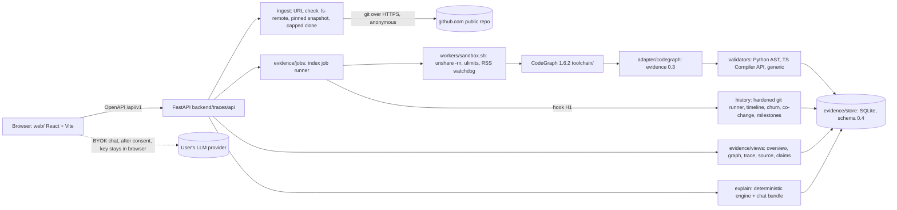

# Traces v1 review package (DRAFT)

> **Draft.** Rows marked **PENDING-LAB** wait on Traces Lab (`ws/lab-acceptance`). Rows marked **UPDATE ON MERGE** wait on an open seat branch. Do not treat this file as a v1 sign-off until those rows are filled in.

| | |
| --- | --- |
| Audited head | `build/traces-v1` at `35499bc7b1fa172bc977009d30d63f082be393cb` ("Keep citation names aligned with the file they show") |
| Audit date | 2026-10-23, about 12:00 to 12:20 IST |
| Audited by | Architect seat, from a fresh clone at the head (`/tmp/audit`) plus the box app served from a separate clean clone |
| Charter | Issue #2, section 7 (acceptance checklist) |
| Last updated | 2026-10-23, 12:35 IST. `build/traces-v1` still at `35499bc`; PR #20 (BYOK chat) and PR #22 (Lab CI and security) are open, not merged (checked with `gh pr view`) |

## 1. Run it

One command, from a clean clone with `uv` and Node 20.19 or newer:

```bash
./scripts/start.sh          # API on 127.0.0.1:8000, web UI on 127.0.0.1:5173
# other ports:
TRACES_API_PORT=8731 TRACES_WEB_PORT=5731 ./scripts/start.sh
```

`start.sh` installs from lockfiles with `--frozen` and `npm ci --ignore-scripts`, starts the API, waits for `/api/v1/health`, then serves the web UI. Data goes to `.traces-data/` in the clone. Indexing needs user namespaces (`unshare -rn`). See [SETUP.md](../SETUP.md).

Full local check, as run for this audit:

```bash
uv run --frozen ruff check . && uv run --frozen mypy
(cd web && npx tsc --noEmit && npx vitest run && npm run check:api && npm run build)
uv run --frozen pytest -q                                  # Python suite
TRACES_NETWORK_TESTS=1 uv run --frozen pytest -q tests/unit/test_ingest.py -k live
TRACES_API_PORT=18801 TRACES_WEB_PORT=18802 bash scripts/e2e_ui.sh   # Playwright, same as CI
```

## 2. Architecture



Path of one request: `POST /repos` checks the URL and confirms anonymous access with `git ls-remote`, then pins a snapshot SHA. `POST /repos/{id}/snapshots/{sha}/index-jobs` clones within caps, runs CodeGraph in the sandbox, adapts and validates the output, writes records to the store, then runs history. Every screen reads the store (D-024). The target repository's code, hooks, installs and tests are never run.

## 3. Seat-to-module map

From [CONTRACTS.md section 6](../CONTRACTS.md).

| Seat | Modules |
| --- | --- |
| Traces | `backend/traces/{evidence,adapter,validators,ingest,core,api}`, `workers/`, `toolchain/` |
| Traces History | `backend/traces/history` (including `gitcmd`), `docs/contracts/history.md`, migrations 0100-0199 |
| Traces UI | `web/`, `backend/traces/explain`, migrations 0200-0299 |
| Traces Lab | `tests/e2e`, CI workflow, `tests/security`, `tests/perf`, second-repo acceptance, `docs/ACCEPTANCE.md` |
| Architect | `docs/CONTRACTS.md`, `docs/DECISIONS.md`, `docs/STATUS.md`, this package, merges into `build/traces-v1` |

## 4. Section 7 checklist on `35499bc`

Every row was run during this audit unless it says otherwise. "Box app" means the instance at API `127.0.0.1:8731` and web `127.0.0.1:5731`, started from a clean clone at `35499bc`.

| # | Charter item | Result | Proof |
| --- | --- | --- | --- |
| 1 | Workflow A: index a public URL pinned to a SHA | **PASS** | `POST /repos` for `fastapi/full-stack-fastapi-template` pinned `b1125d8839482cb7bbae603ddc6d0081bf87532e`. Index job `j_b3030040192949cd992a` succeeded: 4,642 CodeGraph edges, 10,016 static records, history `done` (8,464 records). Web routes `r/:repoId/s/:sha/...` return 200. |
| 2 | Overview, graph and evidence drawer | **PASS** | API overview, components, routes, graph and claim detail all answer on the box app. Default graph: 0 rejected and 0 injected edges, with `hidden: {rejected: 12}`. Browser coverage: CI e2e (`graph.spec.ts`, `overview.spec.ts`, `trace.spec.ts`) plus 16 screenshots in [acceptance/WALKTHROUGH.md](../acceptance/WALKTHROUGH.md). |
| 3 | The 9 Task 002 links are traceable | **PASS** | Fixture claims L1, L2A, L2B, L3, L4, L5, L6, L7, L7T1, L7T2, L8, L9A and L9B are all `verified` on the product index. L8 carries "statically established persistence path". H1 and H2 stay `unvalidated`/`inferred` with the library-contract flag. Trace Items to `get_db`: complete, 5 verified hops, with the static-only disclaimer. |
| 4 | 9 wrong imports never verified; 3 injected negatives rejected and hidden; CT1-CT16 and RT1-RT8 pass | **PASS** | 9 rejected CodeGraph edges, all imports, 0 verified. 3 injected records are `rejected`/`rejected` and absent from the default graph and claim list (default claims 18,468, hidden 12). `pytest tests/contract tests/regression`: 32 collected, all passed inside the full run. CI: contract 17 passed, regression 15 passed. |
| 5 | Git-backed change explanation; co-change shown as a pattern, not causation | **PARTIAL** | History API and screens: timeline 1,537, co-change 144, milestones 8, compare 694 (identity diff, see limits). History records carry "History pattern only; it is not a code dependency and does not show intent." **Gap:** no-key explain about co-change files history records under `code_structure` as facts. `history_patterns` is hard-coded to `[]` (`backend/traces/explain/engine.py:233-234`) and the answer text drops the not-causation caveat. Owner: Traces UI. |
| 6 | No-key explain plus provider (BYOK) mode | **PARTIAL** (UPDATE ON MERGE) | No-key explain is grounded (8 citations on itsdangerous). Chat bundle returns `consent required` and a 3-item outbound manifest. Explain with `api_key` returns 422. The BYOK chat UI is [PR #20](https://github.com/ShaileshRawat1403/traces/pull/20) (`ws/ui-chat` `7db2456`), open and not merged. Update this row when #20 merges. Lab finding F-3 (key echoed in the 422 body, section 9b) also applies here. |
| 7 | Second public repo end to end | **PASS** (box app), **PENDING-LAB** (acceptance record) | `pallets/itsdangerous@672971d66a2ef9f85151e53283113f33d642dabd`, job `j_d4c00e3c7141453898ef` succeeded: 674 edges (310 verified, 3 observed, 268 unvalidated, 46 missing_location, 47 rejected), 1,324 records, 6 components, 50 files, history `done` with 1,988 records, 65 hotspots. Graph: 61 nodes, 50 edges, 47 hidden. Overview: purpose `unknown` with a README interpretation. The INDEX lane reported the same repo and SHA in STATUS, but no artifact or test for it is committed on `build/traces-v1` or `ws/arch-index`. Lab owns the committed acceptance run. |
| 8 | Safe failures | **PASS** (minor findings) | gitlab, ssh and `..` URLs return 422 `invalid_repo_url`. A nonexistent or private repo returns 422 `repo_not_public`. A malformed SHA returns 422 `invalid_sha`. An unknown well-formed SHA fails the job with `sha_not_found`. Source paths `../`, absolute and `-c` return 422. Unknown job returns 404. Oversize (1 MiB cap, `pallets/flask`) fails with `too_large`. Timeout (1 s) fails with `fetch_timeout`. Not live-tested here: `rate_limited` and the missing-key UI (both covered by Lab's `tests/security` in PR #22, not merged). Findings in section 9; Lab F-1 and F-2 (odd file names) in section 9b. |
| 9 | Desktop and mobile, accessibility | **PASS** (synthetic seed), **PENDING-LAB** (real snapshot) | CI e2e run 39716507167: 54 passed, 2 skipped, desktop and phone projects with axe checks. Same script on the fresh clone: 54 passed, 2 skipped (1.1 min). It seeds `octo/synth` (4 files) via `scripts/e2e_seed.py`, not `b1125d8`. Lab is adding a real-snapshot seed. |
| 10 | CI scope | **PARTIAL** | Green on `35499bc`: push [39716507167](https://github.com/ShaileshRawat1403/traces/actions/runs/39716507167) (9/9 jobs) and pull_request [39716512798](https://github.com/ShaileshRawat1403/traces/actions/runs/39716512798). Jobs: lint, types, unit, api, web-build, target, contract, regression, e2e. Missing: `tests/history`, `tests/explain` and web vitest jobs. Lab has them, plus a `security` job, in [PR #22](https://github.com/ShaileshRawat1403/traces/pull/22) (`ws/lab-acceptance` `6384c78`), open and not merged. **PENDING-LAB.** |
| 11 | Docs, screenshots, demo script | **PARTIAL** | Present: README, SETUP, CONTRACTS, DECISIONS (D-001 to D-025, D-H), STATUS, TEST_MAPPING, FIXTURES, THIRD_PARTY_LICENSES, `contracts/openapi.json`, `contracts/history.md`, WALKTHROUGH with 16 screenshots. Missing: a committed demo script (section 10 below is a draft) and `docs/ACCEPTANCE.md`. **PENDING-LAB.** |
| 12 | Discrepancy table | **FAIL** (PENDING-LAB) | `docs/ACCEPTANCE.md` does not exist on `35499bc`. Lab owns it on `ws/lab-acceptance`. Link: [ACCEPTANCE.md](../ACCEPTANCE.md) (dead until Lab merges). |

Also tracked:

| Item | State |
| --- | --- |
| History opt-in path aliases | **UPDATE ON MERGE.** `ws/history-aliases` `cd48b65` (WIP D-H14). Not on the head. |
| `tests/e2e`, `tests/security`, `tests/perf` | **PENDING-LAB.** None exist on the head. Browser specs live in `web/e2e`. `tests/security` (125 cases, 3 strict xfail pinning F-1 to F-3) is in PR #22, not merged. |

## 5. Test totals on `35499bc`

| Suite | Local (fresh clone `/tmp/audit`) | CI |
| --- | --- | --- |
| ruff | clean | lint: pass |
| mypy | no issues in 40 source files | types: pass |
| Python, `pytest -q` (all of `tests/`) | 302 passed, 2 skipped (live-network), 239 s | unit 47 passed / 2 skipped; api 47 passed; contract 17 passed; regression 15 passed |
| Live ingest (`TRACES_NETWORK_TESTS=1`) | 2 passed | not run in CI |
| web `tsc`, `check:api` | clean, API types current | web-build: pass |
| vitest | 13 files, 89 tests passed | **not in CI** (PENDING-LAB, PR #22) |
| web build | index 143.51 kB gzip, GraphPage 144.68 kB gzip | web-build: pass |
| Playwright (`scripts/e2e_ui.sh`, synthetic seed) | 54 passed, 2 skipped | e2e: 54 passed, 2 skipped |

CI runs: [push 39716507167](https://github.com/ShaileshRawat1403/traces/actions/runs/39716507167), [pull_request 39716512798](https://github.com/ShaileshRawat1403/traces/actions/runs/39716512798). Both succeeded on `35499bc`.

## 6. Discrepancy table

**PENDING-LAB.** The table lives in [docs/ACCEPTANCE.md](../ACCEPTANCE.md), owned by Traces Lab. This package will link it and copy no rows from it.

## 7. Key decisions

Full list in [DECISIONS.md](../DECISIONS.md). The ones a reviewer needs:

| Decision | Summary |
| --- | --- |
| D-001, D-002 | uv, Python 3.14.8, FastAPI, SQLite, Vite/React/TS |
| D-003 | MIT license |
| D-004, D-005 | Pipeline emits evidence 0.3; store and API use 0.4, generated from 0.3 |
| D-006 | Sandbox: `unshare -rn`, ulimits, secret env removed; memory cap closed by D-022 |
| D-011 | Rejected claims stay stored and hidden by default; `missing_location` is never verified without recovered locations |
| D-013 | BYOK in the browser only; request models forbid extra fields |
| D-014 | OpenAPI is the UI contract |
| D-021 | Ingest caps: clone 1024 MB, 900 s, 100,000 files, tree 1024 MB |
| D-022 | Index worker, RSS watchdog 6144 MB, index timeout 1800 s |
| D-023 | Explain and chat bundle use the deterministic engine |
| D-024 | Views read the store; compare is an identity diff without H3 |
| D-025 | TypeScript resolution stops at the checkout |
| D-026 | A3 naming is a qualified, documented claim (Task 002 ruling 4) |
| D-H1 to D-H9, D-H6 | History decisions (summary pointer in DECISIONS) |

## 8. Security posture

| Area | What the code does | Checked how |
| --- | --- | --- |
| No target code execution | The target is cloned and read. CodeGraph parses it; validators use Python `ast` and the TypeScript Compiler API. No install, hook, build or test of the target runs. Clone runs with hooks disabled. | Code read of `ingest/fetch.py`, `workers/sandbox.sh`; CT15 asserts isolation |
| Sandboxing | `workers/sandbox.sh`: `unshare -rn` (no network), HOME and telemetry overridden, token and secret env vars removed, ulimits (CPU 1800 s, file 4 GiB, 4096 fds). RSS watchdog (D-022). `TRACES_ISOLATION=none` is recorded and fails CT15. | D-006, D-022; CI `target` and `contract` jobs |
| Ingest limits | Anonymous `ls-remote` only, github.com HTTPS only, SHA validation, size, time and file-count caps | Section 4 row 8 |
| BYOK | Provider keys never reach the backend's logic or storage. The server returns a deterministic answer or a prompt bundle with an outbound manifest; the browser sends it after consent. `api_key` in a request returns 422. **But** the 422 body echoes the rejected value (Lab F-3, blocking, section 9b). | Live 422 on the box app; D-013; PR #22 `test_submitted_key_not_echoed` (xfail) |
| Token handling | v1 never asks for credentials and does not support private repos. History's git runner redacts `gh*_`, `github_pat_` and `user@` URL parts from errors (`history/gitcmd.py`). | `git grep` for key patterns at `35499bc`: only the redaction regex and a test assertion match |
| Outbound network | Backend uses git only (no HTTP client calls in `backend/`). The browser calls the provider only in BYOK chat. | `git grep` for HTTP client calls in `backend/`: none |
| Security tests | **PENDING-LAB.** `tests/security` in PR #22: URLs, fetch limits, hostile repo, no-key and caps, outbound. 3 open findings, section 9b | PR #22, not merged |

## 9. Findings

Blocking v1: **F2** (section 9a) and **F-3** (section 9b). Both are being fixed on the API lane.

### Architect audit findings

None blocks v1 alone. Item 1 is the gap behind row 5.

1. **Explain files co-change as code structure** (Traces UI, `backend/traces/explain/engine.py:233-234`). Grounded citations all go to `code_structure`; `history_patterns` is always `[]`. A co-change answer then lists history records as facts and omits the not-causation caveat. Fix: route `history_pattern` records to `history_patterns` and add the caveat to the answer.
2. **Partial clone left after a fetch timeout** (Traces, `ingest/fetch.py`). A `fetch_timeout` left a `source.partial` directory (~860 KB of pack temp files), against D-021's cleanup promise. A retry removes it.
3. **Unknown SHA accepted at registration** (Traces). A well-formed SHA that does not exist returns 201; the error comes at index time as `sha_not_found`. Safe, but late.
4. **Not live-tested:** `rate_limited` (429 with `Retry-After`) and the missing-key UI path.

## 9a. Independent evidence review (Traces seat)

Full report: [REVIEW_V1_EVIDENCE.md](REVIEW_V1_EVIDENCE.md) (absolute box paths replaced with placeholders). Read-only review of `35499bc` against the Task 002 rulings (Decision 002-B, CLOSEOUT_002, RULINGS), 2026-10-23 about 12:20 IST. The target app was not run.

| Check | Result |
| --- | --- |
| Reproduction of Task 002 run 002b-2 | Exact. 4,642 CodeGraph edges = 4,538 verified + 36 observed + 59 unvalidated + 9 rejected. Validation hash `73db432b...` equal for the review run, the product index and the Task 002 export. Identical `claim_id` sets (10,016 records, 10,016 distinct ids) |
| `claim_id` collisions | 0 (0 recompute mismatches; 34 consolidated records covering 68 rows keep provenance) |
| EOF semantics | 0 violations over 94,472 locations and inputs (16,959 file ranges); RT4 to RT6 pass |
| Wrong imports | The 9 import edges stay `rejected`; all 36 observed carry "observed import statement" |
| `missing_location` | Never verified while it lacks locations. 1,981 records passed through it; every one left only via `location_recovery`; 0 verified records lack locations |
| L1 to L9, H1/H2 | L1 to L9B verified; H1, H2 `unvalidated`, `inferred`, `library_contract` |
| Static vs runtime | No static evidence presented as runtime behavior |

| ID | Severity | Summary | Owner | Blocks v1 | Status |
| --- | --- | --- | --- | --- | --- |
| F1 | medium | CT4 negative assertion is commented out (`tests/contract/_ct.py:47`); behavior is right, the check is dead | Traces | no | Being fixed |
| F2 | medium | `TRACES_ISOLATION=auto` falls back to no isolation with a warning and still stores a ready snapshot; conflicts with the Task 002 rule "stop when isolation cannot be shown" | Traces (API lane) | **yes** | **Being fixed on the API lane** (fail closed unless explicitly opted in; record isolation on the snapshot) |
| F3 | low | Injected controls carry no injected marker in claim lists or graph edges; with `include_rejected` they read as repo facts | Traces (views, API) | no | Being fixed |
| F4 | low | Unfocused graph with `include_rejected` truncates rejected edges away and drops their `hidden_counts` | Traces (views) | no | Being fixed |
| F5 | low | `hidden_counts` in a focused graph is snapshot-wide, not scoped to the focus | Traces (views) | no | Being fixed |
| F6 | low | A3 ruling-4 wording absent from v1 docs (code is right) | Architect | no | **Fixed in this PR** (D-026) |
| F7 | low | `report.py` not ported: no `chain.json` / `coverage.json` per v1 run; L1 to L9 held by tests only | Traces | no | Being fixed, or listed as a limit (section 11) |
| F8 | low | `test_index_worker.py:118-120` comment promises "missing_location never verified" but asserts something weaker | Traces | no | Being fixed |
| F9 | info | R-contains recovered locations have `recovered_by` null (traceable via `location_recovery` history) | Traces | no | Noted, inherited from Task 002 |
| F10 | info | D-011 wording "never verified" is too strong given D-Q9 recovery | Architect | no | **Fixed in this PR** (D-011 now "never verified without recovered locations") |
| F11 | info | The fastapi `b1125d8` product store includes fixture and injected records, by design | none | no | Noted |
| F12 | info | `test_store_concurrency` fails inside `unshare -rn` (loopback down); passes outside | Lab / Traces | no | Noted, environment artifact |

## 9b. Lab security findings (PR #22, `tests/security`)

Pinned as `xfail(strict=True)` in PR #22 (not merged), so a fix flips the test and fails the job until the marker is removed. Lab's markers give the finding id, owner and cause; the severity column is the Architect's assessment.

| ID | Severity | Summary | Owner | Blocks v1 | Status |
| --- | --- | --- | --- | --- | --- |
| F-1 | medium | A tracked file with a non-ASCII name makes the adapter fail closed with `E_PATH`, so the whole repo cannot be indexed (likely `git ls-tree -r` without `-z`, C-quoted paths) | Traces (adapter) | no | Being fixed on the API lane |
| F-2 | low | A tracked file whose name starts with `-` is refused with 422 "path must stay inside the repository"; safe, but unviewable and the message is wrong | Traces (`evidence/views.safe_repo_path`) | no | Being fixed on the API lane |
| F-3 | high | The 422 validation envelope copies pydantic's `errors()` including `input`, so a provider key sent by mistake is echoed in the response body (proxies, browser logs) | Traces (`api/app.py` `_validation_error`) | **yes** | **Being fixed on the API lane** |

## 10. Demo script (10 minutes, DRAFT)

Uses the box app (API `http://127.0.0.1:8731`, web `http://127.0.0.1:5731`) and real data already indexed there. **PENDING-LAB:** Lab owns the committed demo script; replace or link it when it lands.

| Time | Step | What to show |
| --- | --- | --- |
| 0:00 | Open `http://127.0.0.1:5731/` | Home lists `fastapi/full-stack-fastapi-template`, `pallets/itsdangerous` and the failed `pallets/markupsafe` snapshot |
| 1:00 | Open `/r/github.com__fastapi__full-stack-fastapi-template/s/b1125d8839482cb7bbae603ddc6d0081bf87532e` | Overview pinned to the SHA. Components and layers. Purpose stated only where evidence supports it |
| 2:30 | Graph tab | 0 rejected or injected edges shown; the hidden count (12 rejected) is visible. Open one edge's evidence drawer: file, line range, validator, status |
| 4:00 | Trace tab: Items page to `get_db` | 5 verified hops with the static-only disclaimer. L8 says "statically established persistence path", not a runtime write |
| 5:00 | Claims, show hidden | The 9 wrong imports and 3 injected negatives are `rejected`, never `verified` |
| 6:00 | History tab | Timeline, hotspots, co-change with "pattern, not a dependency" text, milestones. Compare is an identity diff (H3 not done) |
| 7:30 | Ask tab, no key | A grounded answer with citations. Show the chat bundle consent and outbound manifest. Do not paste a real key |
| 8:30 | Switch to `/r/github.com__pallets__itsdangerous/s/672971d66a2ef9f85151e53283113f33d642dabd` | Second repo: overview `unknown` purpose with README interpretation, graph with 47 hidden rejected edges |
| 9:15 | Phone width (DevTools 360 px) | Same screens on mobile |
| 9:45 | Close | Limits in section 11 |

## 11. Known limits and deferrals

| Limit | State |
| --- | --- |
| H3: re-index milestone SHAs | Not done. Compare falls back to an identity diff of static claims (D-024) |
| Memory cap (D-006) | Closed by D-022's RSS watchdog. `RLIMIT_AS` stays off (breaks CodeGraph's WebAssembly) |
| e2e in CI | Runs on every push and PR, but on the synthetic `octo/synth` seed. Real-snapshot seed: PENDING-LAB |
| CI coverage | history, explain, vitest and security jobs: PENDING-LAB (PR #22, `ws/lab-acceptance` `6384c78`) |
| BYOK chat UI | UPDATE ON MERGE (PR #20, `ws/ui-chat`) |
| History opt-in aliases | UPDATE ON MERGE (`ws/history-aliases`) |
| Private repos | Out of scope for v1. No credentials are requested |
| Server-side LLM | None by design (D-013) |
| Run report artifacts (F7) | No `chain.json` / `coverage.json` per v1 run unless F7 lands; L1 to L9 traceability is held by the regression tests |
| Static evidence only | Graph and trace are static. A missed relationship is a gap, not proof of absence. Library-contract hops stay inferred |

## 12. Licenses

Traces is MIT ([LICENSE](../../LICENSE)). Third-party software is listed in [THIRD_PARTY_LICENSES.md](../THIRD_PARTY_LICENSES.md), updated in this PR for the shipped web dependencies: shiki 4.5.0, `@shikijs/langs`, `@shikijs/themes`, `@tanstack/react-query`, `@radix-ui/react-dialog`, `@radix-ui/react-tabs` and their transitive packages, plus the bundled TextMate grammars and theme. Shipped web packages: MIT 86, ISC 1, 0BSD 1. No GPL or AGPL dependency. No GitNexus or Code Maat code.
